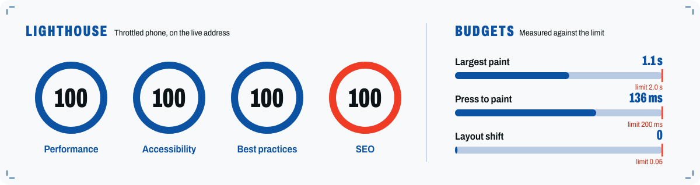
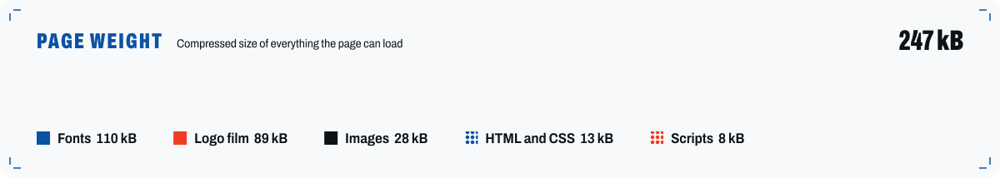
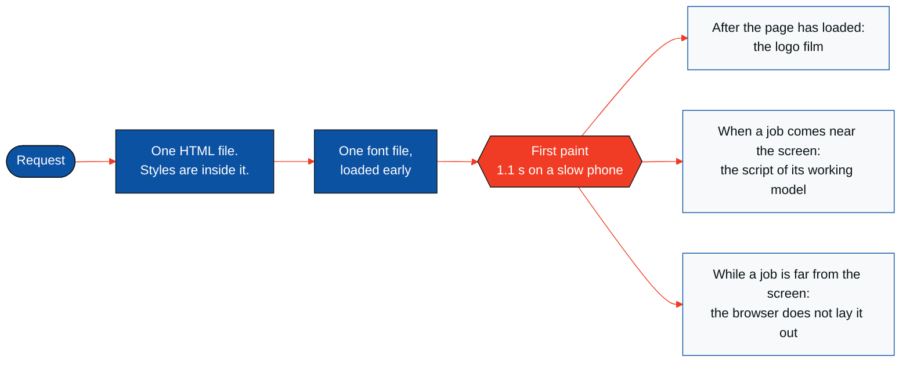
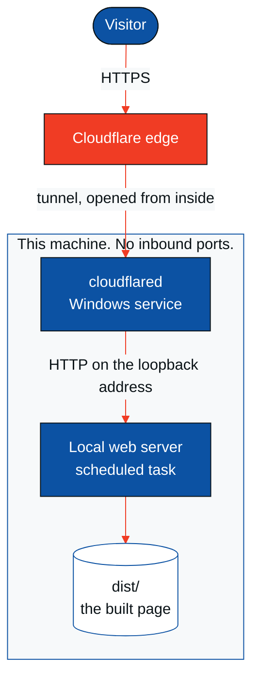
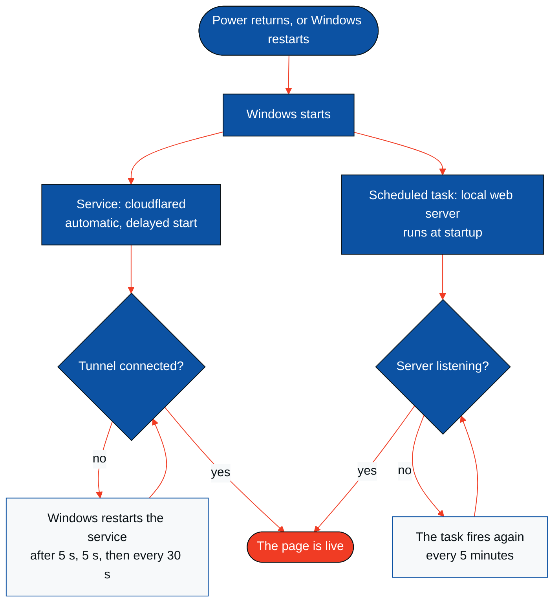
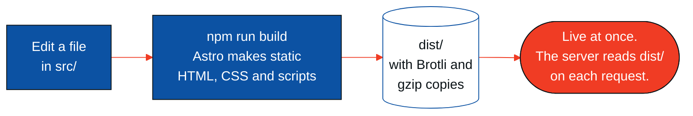
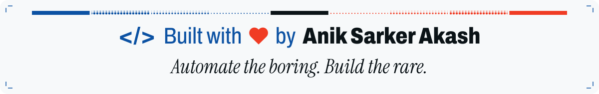

<div align="center">




<p>
  
  
  
  
</p>

<p>
  
  
  
  
  
  
  
</p>

<p>
  <a href="#the-idea">The idea</a> ·
  <a href="#the-five-jobs">The five jobs</a> ·
  <a href="#measured">Measured</a> ·
  <a href="#how-the-page-loads">How it loads</a> ·
  <a href="#how-the-page-is-served">How it is served</a> ·
  <a href="#how-it-recovers">How it recovers</a> ·
  <a href="#quick-start">Quick start</a>
</p>

</div>

---

## The idea

The page is a printer's **proof sheet**. A proof is the print that you check
before the full run, and these five projects are software that is still being
checked.

- The whole page is printed in **two inks**, the brand blue and the brand red, on white stock.
- Headings are set from **two plates** that slide into register as you scroll.
- **Crop marks** sit in the corners of the screen. The **colour bar** at the edge is the navigation.
- The logo forms out of ink, in a film that loops.
- Each project has a **working model** in place of a screenshot.

## The five jobs



| Job | What the working model shows | Status on the page |
| --- | --- | --- |
| **Stock** | A stock ledger. Each line is sealed to the line before it, so an edit to a past line is found. |  |
| **Cheques** | A test rig. A synthetic cheque book goes to a simulated printer. The rig finds a duplicate, missing or misordered sheet. |  |
| **Claims** | One claim collects its signatures stage by stage and becomes a printed bill. |  |
| **Tickets** | A dispatch map. A complaint goes to the closest engineer who is clocked in. |  |
| **Packages** | A carton net. The driver and its settings fold into one signed package. |  |

All data in the working models is made up.

## Measured





| Check | Result | Limit |
| --- | --- | --- |
| Lighthouse, throttled phone | 100 in all four categories | |
| Largest Contentful Paint | 1.1 s | 2.0 s |
| Press to next paint, CPU slowed 4× | 136 ms | 200 ms |
| Cumulative Layout Shift | 0 | 0.05 |
| axe scan of the whole page | 0 violations | 0 |
| Touch targets under 48 px | none | none |

## How the page loads

Only the first screen is needed for the first paint. Everything else waits for
its turn.



## How the page is served

The machine opens no inbound ports. `cloudflared` makes an outbound connection
to Cloudflare, and visitors come down that connection.



The local server has no dependencies. It sends pre-compressed files, gives
hashed assets a one-year cache, sends byte ranges for the logo film, sets
security headers, and sends a visitor who came over plain HTTP to HTTPS.

## How it recovers

After a power loss or a restart, the page comes back with no sign-in.



| Test | Result |
| --- | --- |
| `cloudflared` was killed | A new process started after 5.2 s. The page answered again 1.5 s later. |
| The local web server was killed | The scheduled task started it again after 71 s. The worst case is 5 minutes. |

## From an edit to the live page



To change a status, edit `src/data/jobs.ts`, then set `PROOF_DATE` in the same
file to the day of the change. Every status on the page says "as of" that date.
The hero counts the projects from the same file.

## Quick start

You need Node.js 22.12 or later, and npm.

Install the packages once:

```bash
npm ci
```

Work on the page with live reload:

```bash
npm run dev
```

Build the static page into `dist/`:

```bash
npm run build
```

Serve the built page on `http://localhost:4321`:

```bash
npm run serve
```

Put the page on a public hostname through a Cloudflare Tunnel, with services
that start with Windows and recover by themselves:

```powershell
.\scripts\install-service.ps1 -Hostname <hostname>
```

The details, the steps by hand and the handling of secrets are in
[tunnel/README.md](tunnel/README.md).

## Where things are

| Path | What it holds |
| --- | --- |
| `src/data/jobs.ts` | Name, one-line description and status of each job. The hero, the navigation and the sections read from it. |
| `src/components/jobs/` | One file for each job: the working model and the notes. |
| `src/scripts/` | The behaviour of each working model. Each script loads when its model comes near the screen. |
| `src/lib/e13b.ts` | The characters of the magnetic ink line on the cheque. |
| `src/lib/fonts.ts` | The typefaces, and the fallback faces that stop the page from jumping while a font loads. |
| `src/styles/global.css` | Inks, type, motion and the parts that sections share. |
| `server/serve.mjs` | The local web server. |
| `scripts/` | Build helpers, the Windows start script and the service installer. |
| `tunnel/` | The Cloudflare Tunnel config template and notes. |
| `docs/readme/` | The animated graphics of this file. Their text is drawn as outlines of the page's own typefaces. |

## Standards

- WCAG 2.2 AA: contrast, visible focus, keyboard use, text alternatives.
- Touch targets are at least 48 px.
- When the device asks for reduced motion, the working models do not play by
  themselves and show their result at once. The meaning stays.
- The logo film loops on every device. Pressing the logo pauses it and shows
  the still logo.
- Fonts, images and scripts are served from this site. The one third-party
  request is Cloudflare Web Analytics, which the Cloudflare zone adds to the
  page. It sets no cookies. To block it, remove its two hosts from the
  `Content-Security-Policy` in `server/serve.mjs`.

---

<div align="center">



Designed and developed by **Anik Sarker Akash**

</div>
